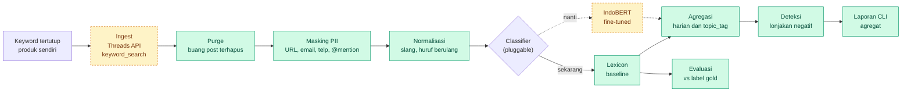
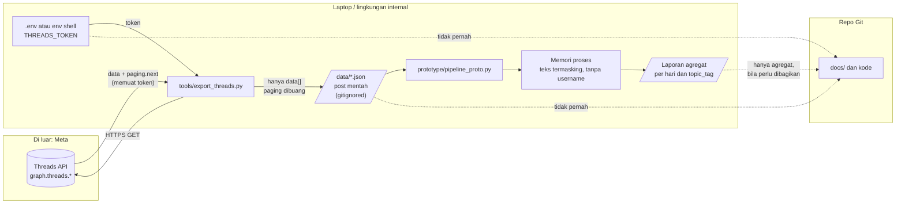
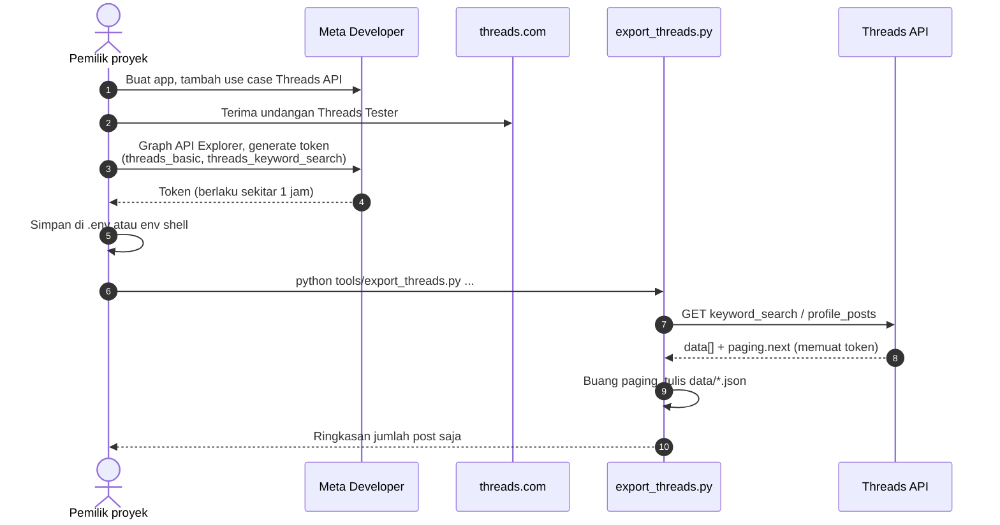

# Sentiment Analysis Threads

> Memantau sentimen publik di **Meta Threads** terhadap produk sendiri: tren harian, lonjakan negatif, dan topik pemicunya. Internal, satu tenant, **agregat saja**.


Tahap saat ini: riset dan verifikasi akses data. Kode baru berupa prototype throwaway dan skrip ekspor.

## Daftar isi

- [Scope](#scope)
- [Alur proses](#alur-proses)
- [Alur data](#alur-data)
- [Alur akses API dan token](#alur-akses-api-dan-token)
- [Status](#status)
- [Mulai cepat](#mulai-cepat)
- [Perkakas](#perkakas)
- [Struktur repo](#struktur-repo)
- [Temuan kunci](#temuan-kunci)
- [Dokumen](#dokumen)
- [Langkah berikutnya](#langkah-berikutnya)
- [Konvensi](#konvensi)

## Scope

| | |
|---|---|
| **Pengguna** | Internal, satu tenant |
| **Objek** | Produk sendiri dan tren seputar produk atau kategori produk. Kompetitor masuk tahap 2 |
| **Data** | Threads API resmi (`keyword_search`) dengan daftar keyword tertutup |
| **Output** | Tren sentimen, lonjakan negatif, topik pemicu. Tidak ada profil per akun atau pencarian per orang |
| **Di luar scope** | Isu publik umum, politik, tokoh, scraping |

Rincian: [docs/scope-statement.md](docs/scope-statement.md).

## Alur proses

Dari kebutuhan sampai laporan. Garis putus-putus adalah langkah yang belum dibangun atau belum diizinkan.



| Tahap | Status | Catatan |
|---|---|---|
| Ingest | skrip siap, belum diuji nyata | `keyword_search` hanya mengembalikan post akun sendiri sebelum App Review |
| Purge, masking, normalisasi | jalan di prototype | username tidak dibawa ke tahap berikutnya |
| Classifier | lexicon jalan; IndoBERT stub | lexicon gagal pada sarkasme dan pertanyaan |
| Agregasi dan lonjakan | jalan di prototype | ambang `min_n=4`, `thr=0.6` |
| Evaluasi | jalan pada data sintetis | akurasi 88% pada data buatan sendiri bukan ukuran kualitas |

## Alur data

Data mengalir satu arah dan menyempit: semakin ke kanan, semakin sedikit informasi yang bisa mengidentifikasi orang.



Batas data yang dijaga:

| Data | Disimpan di | Masuk Git? |
|---|---|---|
| Token | `.env` atau variabel shell | tidak |
| Respons mentah (`paging.next` memuat token) | tidak disimpan; dibuang oleh skrip ekspor | tidak |
| Post mentah (`data[]`) | `data/*.json` | tidak |
| Teks termasking | memori proses | tidak |
| Agregat (jumlah per hari dan tag) | laporan CLI | boleh, setelah ditinjau |

## Alur akses API dan token

Urutan memperoleh akses sampai ekspor pertama.



Tanpa App Review, hasil hanya mencakup post akun tester sendiri. Persetujuan App Review adalah penentu jadwal untuk data publik; lihat [draf pertanyaan ke Meta](docs/meta-support-questions.md).

## Status

| Item | Status |
|---|---|
| Riset kebutuhan, data source, arsitektur, privasi | selesai (draf) |
| Verifikasi poin terbuka Threads API | selesai, sebagian masih terbuka |
| Draf pertanyaan ke Meta | dirapikan, belum dikirim |
| Uji empiris Threads API | fase 0 dan sebagian `keyword_search` selesai ([hasil](docs/research/threads-api-test-results.md)) |
| Prototype pipeline | jalan pada data sintetis; belum diuji dengan data nyata |
| Skrip ekspor | belum pernah dijalankan terhadap API |

## Mulai cepat

Python 3.14, hanya pustaka standar. Semua perintah dari root repo (PowerShell).

```powershell
# 1. Jalankan prototype pada data sintetis (tanpa jaringan, tanpa token)
python prototype/pipeline_proto.py

# 2. Siapkan token: salah satu cara
$env:THREADS_TOKEN = "..."          # (a) hanya di sesi shell, atau
#   (b) buat berkas .env di root repo berisi satu baris: THREADS_TOKEN=...

# 3. Ekspor data nyata
python tools/export_threads.py profile --username <akun-sendiri> --limit 25 --pages 2

# 4. Jalankan pipeline pada data nyata (tanpa label 'gold', evaluasi dilewati)
python prototype/pipeline_proto.py data/profile_<akun-sendiri>.json
```

## Perkakas

| Berkas | Fungsi |
|---|---|
| `tools/export_threads.py` | ekspor post dari Threads API ke `data/*.json`. Mode `profile` dan `keyword`. Token dari `THREADS_TOKEN` (env shell atau `.env`), tidak pernah ditulis atau dicetak |
| `prototype/pipeline_proto.py` | prototype throwaway: purge, masking, normalisasi, klasifikasi lexicon, agregasi harian, evaluasi |
| `prototype/fixture_posts.json` | 17 post sintetis berbentuk respons Threads, lengkap dengan label `gold` |
| `.env.example` | daftar variabel lingkungan (tanpa nilai) |

Variabel lingkungan:

| Variabel | Wajib | Keterangan |
|---|---|---|
| `THREADS_TOKEN` | ya (untuk ekspor) | token akses; dari Graph API Explorer berlaku sekitar 1 jam |
| `THREADS_API_BASE` | tidak | default `https://graph.threads.com/v1.0`; di Explorer `https://graph.threads.net/v1.0` terbukti bekerja |

Catatan:
- Variabel yang sudah diset di shell **tidak ditimpa** oleh `.env`.
- `data/` dan `.env` di-gitignore. Jangan commit data nyata atau token.
- Respons `profile_posts` memuat URL `paging.next` yang berisi token; skrip ekspor membuangnya. Jangan menyimpan respons mentah atau menempelkannya ke chat dan issue.
- Token di `.env` tersimpan sebagai teks biasa. Hapus setelah sesi uji.
- Nama field di `export_threads.py` sebagian asumsi; yang terverifikasi ada di [hasil uji](docs/research/threads-api-test-results.md).

## Struktur repo

```text
.
├── README.md
├── .env.example            # contoh variabel (tanpa nilai)
├── .gitignore              # data/, .env, __pycache__/
├── docs/
│   ├── scope-statement.md
│   ├── meta-support-questions.md
│   ├── test-plan-keyword-search.md
│   └── research/
│       ├── threads-sentiment-analysis.md
│       ├── threads-api-open-questions.md
│       ├── threads-profile-discovery.md
│       └── threads-api-test-results.md
├── prototype/              # throwaway
│   ├── pipeline_proto.py
│   └── fixture_posts.json
├── tools/
│   └── export_threads.py
└── data/                   # lokal, gitignored
```

## Temuan kunci

- Keyword search resmi tersedia dengan izin `threads_keyword_search`: maksimum 2.200 query per 24 jam, 100 hasil per request.
- Sebelum App Review, pencarian hanya menjangkau post akun sendiri; akun kompetitor butuh Advanced Access.
- Tidak ada endpoint trending yang terdokumentasi; tren dideteksi sendiri dari volume keyword dan `topic_tag`.
- Scraping dilarang tanpa izin tertulis Meta.
- Deteksi post terhapus untuk hasil pencarian publik tidak didokumentasikan.
- Boleh tidaknya fine-tuning dengan data Threads belum jelas di Platform Terms.
- UU PDP No. 27/2022 kemungkinan berlaku; DPIA diperlukan sebelum produksi.

## Dokumen

| Berkas | Isi |
|---|---|
| [docs/scope-statement.md](docs/scope-statement.md) | keputusan scope dan batasan desain |
| [docs/research/threads-sentiment-analysis.md](docs/research/threads-sentiment-analysis.md) | riset kebutuhan, data source, arsitektur, privasi dan legal |
| [docs/research/threads-api-open-questions.md](docs/research/threads-api-open-questions.md) | verifikasi poin terbuka Threads API |
| [docs/research/threads-profile-discovery.md](docs/research/threads-profile-discovery.md) | ringkasan `profile_lookup` dan `profile_posts` |
| [docs/research/threads-api-test-results.md](docs/research/threads-api-test-results.md) | hasil uji empiris API |
| [docs/meta-support-questions.md](docs/meta-support-questions.md) | draf pertanyaan untuk Meta Developer Support |
| [docs/test-plan-keyword-search.md](docs/test-plan-keyword-search.md) | rencana uji empiris `keyword_search` |

## Langkah berikutnya

1. Jalankan ekspor pertama terhadap akun sendiri, lalu pipeline pada hasilnya.
2. Tinjau dan kirim [draf pertanyaan ke Meta](docs/meta-support-questions.md).
3. Selesaikan uji tersisa: urutan TOP vs RECENT, `search_mode=TAG`, paginasi, kuota, header rate limit, kedalaman riwayat.
4. Kumpulkan set berlabel (sekitar 100 sampai 200 post) dan aktifkan IndoBERT setelah unduhan model disetujui.
5. DPIA dan keputusan legal oleh pemilik proyek.

## Konvensi

- Bahasa Indonesia; nama berkas Inggris huruf kecil dengan tanda hubung.
- Klaim ditandai `fakta | asumsi | usulan | terbuka`; klaim fakta mencantumkan sumber primer dan tanggal akses.
- Jangan menyimpan token, secret, atau data pribadi di repo.
- Dokumen riset bukan nasihat hukum.
