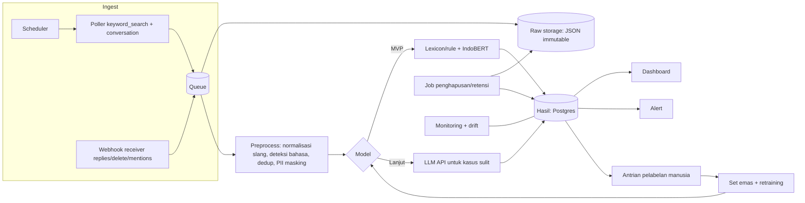

# Riset: Sentiment Analysis dari Meta Threads

Tanggal riset dan akses semua sumber: **2026-10-31**.

Legenda tag: **[fakta]** (ada sumber primer + URL + tanggal akses), **[asumsi]**, **[usulan]**, **[terbuka]** (tidak bisa diverifikasi dari sumber primer; jangan dianggap benar).

Catatan metode:
- Halaman dokumentasi Threads kini berada di `developers.facebook.com/documentation/threads/...` (jalur lama `/docs/threads` mengarah ke sini). URL di bawah adalah yang benar-benar dibaca.
- Pembacaan halaman dilakukan lewat alat fetch yang meringkas halaman. Beberapa halaman Meta (kebijakan) tersaji berbahasa Indonesia sesuai locale, dan kutipan di sini berupa parafrase, bukan teks asli. **[terbuka]** Kata-kata persis tiap klausul perlu dibaca ulang manual oleh manusia sebelum dipakai sebagai dasar keputusan legal.
- Dokumen ini bukan nasihat hukum.
- Tidak ada artikel sekunder yang dijadikan dasar klaim fakta.

---

## 1. Kebutuhan

Bagian ini seluruhnya **[usulan]/[asumsi]** karena proyek belum punya brief. Angka-angka adalah titik awal diskusi.

### 1.1 Use case

| # | Use case | Output utama | Tag |
|---|---|---|---|
| 1 | Brand monitoring (mention merek, produk, tagar) | tren sentimen harian, lonjakan negatif, topik pemicu | usulan |
| 2 | Isu publik (kebijakan, peristiwa, tokoh publik) | peta opini per topik, bukan profil per orang | usulan |
| 3 | Kompetitor (perbandingan share of voice dan sentimen) | perbandingan merek berdampingan | usulan |

- **[usulan]** MVP fokus use case 1, dengan keyword/tagar yang dikelola sendiri. Use case 2 dan 3 menambah risiko legal (lihat bagian 4: larangan surveillance/profiling di Platform Terms) dan sebaiknya ditunda sampai keputusan legal.
- **[terbuka]** Siapa pengguna akhir, merek apa, dan apakah ini produk internal atau layanan untuk klien. Jawabannya menentukan jenis akses Meta (lihat 2.1: Tech Provider vs non-Tech Provider).

### 1.2 Bahasa

- **[asumsi]** Teks utama: Indonesia informal, campur Inggris (code-mixing), slang (mis. singkatan, huruf berulang, emoji), kadang bahasa daerah dan sarkasme. Belum ada sampel nyata dari Threads.
- **[fakta]** Model pralatih Indonesia tersedia: IndoBERT (`indobenchmark/indobert-base-p1`, MIT, sekitar 124,5 juta parameter, dilatih pada korpus Indo4B sekitar 23,43 GB). Kartu model tidak mencantumkan keterbatasan atau risiko. Sumber: https://huggingface.co/indobenchmark/indobert-base-p1 (diakses 2026-10-31).
- **[fakta]** IndoNLU adalah benchmark 12 tugas untuk bahasa Indonesia, dengan IndoBERT dan baseline dirilis. Sumber: https://arxiv.org/abs/2009.05387 (diakses 2026-10-31).
- **[terbuka]** Seberapa baik IndoBERT yang dilatih pada SmSA/EmoT menggeneralisasi ke teks Threads (domain berbeda). Tidak ada sumber primer; harus diukur sendiri.
- **[usulan]** Sarkasme dan code-mixing dianggap kelas sulit; sediakan label `sarkasme?` dan `bahasa-campuran` di set evaluasi agar errornya bisa diukur terpisah.

### 1.3 Volume dan latensi

- **[fakta]** Batas pencarian keyword resmi: 2.200 query per 24 jam rolling per pengguna (lintas aplikasi), maksimum 100 hasil per request. Sumber: https://developers.facebook.com/docs/threads/keyword-search (diakses 2026-10-31). Batas atas teoretis per akun adalah sekitar 220 ribu post per hari jika semua query penuh dan paginasi tersedia.
- **[terbuka]** Apakah paginasi hasil keyword search bisa melewati halaman pertama dan berapa total hasil yang dapat ditarik per query. Halaman dokumen tidak menyatakan batas total.
- **[asumsi]** Target MVP: 5-20 keyword, 1.000-50.000 post per hari, latensi hasil di dashboard 15-60 menit (near-real-time cukup; bukan streaming).
- **[usulan]** Alert lonjakan negatif memakai webhook hanya bila akun milik klien sendiri (lihat 2.1); untuk pencarian publik pakai polling terjadwal.

### 1.4 Granularitas

| Tingkat | Isi | Rekomendasi |
|---|---|---|
| Dokumen (post/balasan) | positif / netral / negatif (+ skor) | **MVP** |
| Emosi | mis. marah, takut, senang, cinta, sedih | tahap lanjut |
| Aspek (ABSA) | sentimen per aspek (harga, layanan, kualitas) | tahap lanjut, butuh label sendiri |

- **[fakta]** Dataset berlabel publik: SmSA (3 label: positif/negatif/netral; 11.000 train, 1.260 valid, 500 test, dikumpulkan dari komentar/ulasan berbagai platform) dan EmoT (sekitar 4.000 tweet, 5 emosi: anger, fear, happy, love, sadness). Kartu dataset menyatakan benchmark IndoNLU berlisensi MIT. Sumber: https://huggingface.co/datasets/indonlp/indonlu (diakses 2026-10-31).
- **[terbuka]** Kartu dataset memuat galat metadata YAML dan tidak merinci lisensi per subset; verifikasi lisensi tiap subset ke sumber aslinya sebelum penggunaan komersial.

### 1.5 Metrik evaluasi

- **[usulan]** Macro-F1 (utama, karena kelas tak seimbang), F1 per kelas, matriks konfusi, akurasi sebagai pembanding, dan Cohen's kappa antar-pelabel.
- **[usulan]** Set uji emas dari Threads sendiri: minimal 1.000-2.000 post berlabel, dua pelabel per item, stratifikasi per keyword dan per jenis bahasa. Angka ini **[asumsi]**.
- **[usulan]** Metrik bisnis: ketepatan alert (precision lonjakan negatif), waktu deteksi.

### 1.6 Non-fungsional

- **[usulan]** Idempoten (ingest ulang aman), jejak asal data (ID, waktu ambil), penghapusan konten yang dihapus pengguna (lihat bagian 4), enkripsi at-rest, akses berbasis peran, log audit, biaya terprediksi, dapat diulang (model dan data berversi).
- **[fakta]** Token akses: kode otorisasi berlaku 1 jam; token short-lived 1 jam; long-lived 60 hari. Sumber: https://developers.facebook.com/documentation/threads/get-started.md (diakses 2026-10-31). Maka perlu refresh token terjadwal.

---

## 2. Sumber data

### 2.1 Threads API resmi

| Aspek | Temuan | Tag | Sumber (akses 2026-10-31) |
|---|---|---|---|
| Base URL | `https://graph.threads.com/v1.0/` (juga `graph.threads.net`) | fakta | https://developers.facebook.com/documentation/threads/overview.md |
| Keyword search | `GET /keyword_search` dengan `q`, `search_type` (`TOP`/`RECENT`), `search_mode` (`KEYWORD`/`TAG`), `media_type`, `since`, `until`, `limit` (default 25, maks 100), `author_username` | fakta | https://developers.facebook.com/docs/threads/keyword-search |
| Batas `since` | minimal timestamp `1688540400` | fakta | sama di atas |
| Field hasil search | `id, text, media_type, permalink, timestamp, username, has_replies, is_quote_post, is_reply` (contoh); `owner` dan beberapa field lain **tidak** dikembalikan | fakta | https://developers.facebook.com/documentation/threads/reference/media-retrieval.md |
| Cakupan | media publik; tanpa persetujuan `threads_keyword_search`, hanya post milik pengguna terotorisasi | fakta | https://developers.facebook.com/docs/threads/keyword-search |
| Keyword sensitif/ofensif | mengembalikan array kosong | fakta | sama |
| Rate limit search | 2.200 query/24 jam rolling per pengguna, lintas aplikasi; query tanpa hasil tidak dihitung | fakta | sama |
| Rate limit umum | panggilan/24 jam = 4.800 x impresi (minimum impresi 10), per pasangan app-pengguna app; ada juga batas waktu CPU | fakta | https://developers.facebook.com/documentation/threads/overview.md |
| Balasan | `GET {media-id}/replies` (balasan langsung) dan `GET {media-id}/conversation` (daftar rata semua kedalaman, hanya untuk post root) | fakta | https://developers.facebook.com/documentation/threads/retrieve-and-manage-replies/replies-and-conversations.md |
| Izin baca balasan | `threads_read_replies` untuk GET endpoint balasan | fakta | https://developers.facebook.com/documentation/threads/get-started.md |
| Profil pengguna lain | `GET /profile_lookup?username=`; izin `threads_profile_discovery`; hanya profil publik dengan minimal 100 pengikut; 1.000 request/24 jam; pada akses standar hanya akun resmi Meta (@meta, @threads, @instagram, @facebook) | fakta | https://developers.facebook.com/documentation/threads/threads-profiles |
| Insights | `GET /{media-id}/insights`, `GET /{user-id}/threads_insights`; izin `threads_manage_insights`; untuk Threads milik pengguna terotorisasi | fakta | https://developers.facebook.com/documentation/threads/insights |
| Webhook | topik `replies` (izin `threads_basic` + `threads_read_replies`), `delete` (`threads_delete`), `mentions` (`threads_manage_mentions`), `publish`; tidak ada notifikasi untuk akun privat; app harus lolos App Review Advanced Access untuk semua field; pemilik media non-privat; bisnis terhubung harus terverifikasi | fakta | https://developers.facebook.com/docs/threads/webhooks |
| Izin dasar | `threads_basic` wajib untuk semua endpoint | fakta | https://developers.facebook.com/documentation/threads/get-started.md |
| App Review | tiap izin harus disetujui lewat App Review sebelum pengguna tanpa peran di app dapat memberikannya; app harus dipublikasikan | fakta | sama |
| Business verification | "Advanced Access now requires Business Verification" (sejak 1 Feb 2023); tidak perlu bila hanya dipakai orang ber-peran di app | fakta | https://developers.facebook.com/docs/development/release/business-verification |
| Aset publish app | ikon, URL Privacy Policy, URL/callback penghapusan data, kontak DPO jika berbisnis di UE | fakta | https://developers.facebook.com/documentation/threads/get-started/create-an-app.md |
| Pemberian izin | profil publik: izin berlaku 90 hari, diperpanjang dengan refresh token; profil privat harus memberi ulang | fakta | https://developers.facebook.com/documentation/threads/get-started.md |

Hal yang **tidak** bisa diverifikasi:

- **[terbuka]** Syarat dan waktu proses App Review khusus `threads_keyword_search` (dokumen hanya menyatakan harus disetujui; tidak ada halaman proses review Threads di indeks dokumen).
- **[terbuka]** Apakah `threads_keyword_search` memerlukan Business Verification/Advanced Access untuk aplikasi non-Tech Provider. Halaman webhook dan business verification menyebutnya untuk Advanced Access; kaitannya persis dengan keyword search tidak dinyatakan.
- **[terbuka]** Apakah `/replies` dan `/conversation` bisa dipakai untuk post milik orang lain (publik). Halaman tidak menyatakan eksplisit; halaman izin menyebut `username`/`permalink` "hanya untuk pengguna publik dan milik sendiri".
- **[terbuka]** Retensi: dokumentasi tidak menyebut berapa lama data API boleh disimpan atau perilaku untuk post yang dihapus pada keyword search. Halaman keyword search dan media retrieval tidak membahas post terhapus.
- **[terbuka]** Mekanisme resmi untuk mengetahui bahwa post hasil pencarian publik telah dihapus (webhook `delete` hanya untuk akun yang memberi izin ke app).
- **[terbuka]** Halaman pembatasan penggunaan (ketentuan "display solely to creator") ada di konteks API publikasi; apakah berlaku untuk hasil pencarian tidak dinyatakan.
- **[fakta]** Dokumen Threads menyatakan bahwa API "memungkinkan orang membuat dan memublikasikan konten atas nama seseorang" dan menampilkan post itu hanya kepada pembuatnya (konteks publikasi). Sumber: https://developers.facebook.com/documentation/threads/overview.md (2026-10-31).

Implikasi desain:

- **[usulan]** Satu akun Threads pengelola (dengan token valid) menjalankan pencarian. Karena batas 2.200 query/24 jam berlaku per pengguna lintas aplikasi, jangan berbagi akun itu dengan aplikasi lain.
- **[asumsi]** Aplikasi sentimen internal berperan pengembang saja (sehingga tanpa Business Verification) mungkin cukup di tahap uji; untuk pengguna luar harus lewat App Review. Belum terverifikasi untuk izin `threads_keyword_search`.

### 2.2 Pihak ketiga dan scraping

| Opsi | Risiko | Tag | Sumber |
|---|---|---|---|
| Scraping/bot/crawler produk Meta | Dilarang tanpa izin tertulis eksplisit; menyetujui Terms bukan izin; dilarang memindahtangankan/menjual/melisensikan data hasil kumpul; wajib patuh robots.txt, identitas IP/user-agent sendiri; Meta dapat mencabut kapan saja; ada indemnity | fakta | https://web.facebook.com/apps/site_scraping_tos_terms.php (Meta Automated Data Collection Terms; diakses 2026-10-31) |
| Platform Terms | Dilarang menjual/melisensikan/membeli Data Platform, memakai data untuk pengawasan, diskriminasi, atau keputusan kelayakan, dan membangun profil pengguna tanpa persetujuan sah (lihat bagian 4) | fakta | https://developers.facebook.com/terms/dfc_platform_terms/ |
| Vendor data pihak ketiga (reseller feed Threads) | Status izin dari Meta tidak dapat diverifikasi dari sumber primer | terbuka | - |
| Teks Threads Terms/Supplemental Terms soal akses otomatis | Halaman `help.instagram.com/769983657850450` dan `/515230437301944` tidak terbaca isinya oleh alat (hanya judul "Help Center") | terbuka | - |

- **[usulan]** Jangan scraping dan jangan beli dari vendor yang tidak bisa membuktikan izin Meta. Risiko: pemblokiran akun, tuntutan, dan kontaminasi dataset legal.

### 2.3 Sumber pelengkap

| Sumber | Kegunaan | Status | Tag |
|---|---|---|---|
| SmSA (IndoNLU) | pelatihan/evaluasi awal sentimen 3 kelas | MIT per kartu dataset (lisensi per subset belum terverifikasi) | fakta (kartu: https://huggingface.co/datasets/indonlp/indonlu, 2026-10-31) |
| EmoT (IndoNLU) | emosi tweet Indonesia | sama | fakta (sama) |
| NusaX-Senti | sentimen paralel Indonesia + 10 bahasa daerah + Inggris; CC BY-SA 4.0; teks Indonesia disampel dari SmSA | CC BY-SA 4.0 (konsekuensi share-alike untuk model/turunan belum dikaji) | fakta (https://arxiv.org/abs/2205.15960, 2026-10-31) |
| X, Reddit, YouTube, berita | pembanding lintas platform, data latih tambahan | ToS/API masing-masing belum diteliti dalam riset ini | terbuka |

- **[usulan]** Mulai dari SmSA+EmoT+NusaX untuk baseline, lalu wajib pelabelan data Threads sendiri (domain shift).
- **[terbuka]** Implikasi lisensi CC BY-SA 4.0 (NusaX) untuk bobot model yang dilatih darinya.

### 2.4 Perbandingan ringkas

| Kriteria | Threads API resmi | Scraping | Vendor pihak ketiga | Dataset publik |
|---|---|---|---|---|
| Legalitas ToS | sesuai (dengan izin) | dilarang tanpa izin tertulis | tidak terverifikasi | umumnya OK, cek lisensi |
| Cakupan keyword publik | ada (perlu App Review) | tinggi | tidak diketahui | tidak relevan merek |
| Stabilitas | bergantung kebijakan Meta | rapuh | bergantung vendor | stabil |
| Batas | 2.200 query/24 jam/pengguna, 100/request | bebas (tapi dilarang) | kontrak | tidak ada |
| Biaya | gratis API (biaya infrastruktur) | tinggi (anti-bot) | berbayar | gratis |
| Rekomendasi | **utama** | hindari | hindari sampai terbukti | **pelengkap latih** |

---

## 3. Arsitektur

### 3.1 Diagram



```
Threads API --> [poller/webhook] --> queue --> raw store
                                          \--> preprocess --> model --> hasil DB --> dashboard/alert
                                                                  ^                  |
                                                  retrain <-- label manusia <---------+
                      job retensi/hapus ---------> raw store + hasil DB
```

### 3.2 Komponen

| Komponen | Usulan MVP | Tahap lanjut | Tag |
|---|---|---|---|
| Ingestion | polling terjadwal `keyword_search` (`RECENT`, `since` = watermark terakhir) + `conversation` untuk post berbalasan; pengelola token (refresh 60 hari) | webhook untuk akun klien (`replies`, `delete`, `mentions`) | usulan |
| Queue | tabel antrean di Postgres atau Redis | Kafka/SQS bila volume besar | usulan |
| Raw storage | JSON per post di object storage/tabel, dengan `fetched_at`, ID, permalink | partisi per tanggal, kunci enkripsi per tenant | usulan |
| Preprocessing | lowercase, normalisasi huruf berulang, kamus slang, pemisahan emoji/tagar, deteksi bahasa, dedup, penyamaran @username/URL/nomor | model normalisasi, tangani code-mixing | usulan |
| Model | lihat 3.3 | lihat 3.3 | usulan |
| Hasil | Postgres (post_id, label, skor, versi_model, waktu) | warehouse kolumnar | usulan |
| Dashboard | Metabase/Grafana atau halaman kecil sendiri | Akses per tenant, drilldown | usulan |
| Monitoring | log job, metrik kuota, rasio kelas harian, panjang teks | uji distribusi (PSI/KL) pada skor/panjang/bahasa | usulan |
| Drift | ukur macro-F1 mingguan pada sampel berlabel | pemicu retraining otomatis | usulan |
| Human loop | ambil sampel acak + sampel skor mendekati ambang -> alat label sederhana | active learning | usulan |

- **[fakta]** Ingestion webhook memerlukan app dipublikasikan dan bisnis terverifikasi, dan tidak mengirim notifikasi dari akun privat (lihat tabel 2.1). Sumber: https://developers.facebook.com/docs/threads/webhooks (2026-10-31). Karena itu webhook tidak menggantikan polling untuk pencarian publik.
- **[terbuka]** Webhook `delete` hanya mencakup akun yang memberi izin; tidak ada sumber primer untuk deteksi penghapusan pada post hasil pencarian publik. Usulan: cek ulang berkala (mis. sampel/usia > N hari) lewat `GET /{media-id}` dan hapus bila tidak lagi ada **[usulan]**; perilaku API untuk post terhapus **[terbuka]**.

### 3.3 Pilihan model

| Opsi | Akurasi | Biaya | Latensi | Catatan | Tag |
|---|---|---|---|---|---|
| Lexicon/rule | rendah-sedang, lemah di sarkasme/code-mixing | sangat murah | milidetik | baseline, penjelas | asumsi |
| IndoBERT fine-tuned (SmSA/EmoT + data Threads) | umumnya lebih tinggi dari lexicon; belum terukur di Threads | CPU cukup untuk inferensi, GPU untuk latih | puluhan ms | MIT; model card tanpa limitasi tertulis | asumsi (+ fakta lisensi/ukuran, lihat 1.2) |
| LLM API zero/few-shot | berpotensi terbaik pada sarkasme/aspek; belum terukur | per token, terbesar | detik | kirim teks pengguna ke pihak ketiga -> implikasi PDP | asumsi |

- **[usulan]** MVP: IndoBERT fine-tuned sebagai klasifier utama, lexicon sebagai fitur/cadangan, dan LLM hanya untuk sampel kecil (set emas bantu, kasus berkepercayaan rendah). Putuskan setelah mengukur macro-F1 di set Threads sendiri.
- **[terbuka]** Harga dan kebijakan retensi data LLM API saat ini; cek dokumentasi penyedia terpilih sebelum memutuskan.
- **[terbuka]** Platform Terms tidak membahas secara eksplisit pelatihan model memakai Data Platform (kata persisnya per fetch: tidak menyebut AI/ML oleh Developer). Anggap pelatihan dengan teks Threads sebagai risiko legal sampai ada konfirmasi tertulis; larangan penggunaan di luar tujuan di Developer Documentation tetap berlaku (Platform Terms 3.a.viii, per ringkasan). Sumber: https://developers.facebook.com/terms/dfc_platform_terms/ (2026-10-31).

### 3.4 MVP vs lanjutan

| Fase | Isi | Tag |
|---|---|---|
| MVP (4-6 minggu, asumsi) | 1 akun pengelola, 5-20 keyword, polling per jam, raw store, preprocessing dasar, IndoBERT baseline dari SmSA+EmoT, dashboard tren, 1.000-2.000 label Threads, job hapus/retensi | usulan |
| Tahap 2 | fine-tune dengan label Threads, deteksi drift, alert, balasan (`conversation`), kolom emosi | usulan |
| Tahap 3 | ABSA, LLM untuk kasus sulit, multi-tenant, webhook akun klien | usulan |

### 3.5 Estimasi biaya kasar (semua asumsi, bukan harga resmi)

| Item | Estimasi bulanan MVP | Tag |
|---|---|---|
| Server/VM kecil + Postgres + object storage | USD 20-80 | asumsi |
| Inferensi IndoBERT di CPU | termasuk server di atas | asumsi |
| Pelatihan sesekali (GPU sewa beberapa jam) | USD 5-30 per sesi | asumsi |
| Pelabelan manusia (2.000 item x 2 pelabel) | satu kali, bergantung tarif lokal | asumsi |
| LLM API untuk ~1-5% data | bergantung harga token saat ini | terbuka |
| Threads API | tidak ada biaya yang ditemukan di dokumen | terbuka (tidak ada halaman harga yang dibaca) |

---

## 4. Privasi dan legal

Bukan nasihat hukum; **[usulan]** konsultasikan ke penasihat hukum sebelum peluncuran.

### 4.1 UU PDP No. 27/2022 (ringkasan dari teks resmi)

Sumber teks: https://jdih.komdigi.go.id/produk_hukum/view/id/832/t/crc32/ (diakses 2026-10-31); metadata: https://peraturan.bpk.go.id/Details/229798/uu-no-27-tahun-2022 (diakses 2026-10-31).

- **[fakta]** Data Pribadi = data tentang orang perseorangan yang teridentifikasi atau dapat diidentifikasi, sendiri atau digabung informasi lain (Pasal 1 angka 1). Username, teks, dan foto profil Threads yang bisa dikaitkan ke orang termasuk dalam definisi ini secara umum **[asumsi]** (tidak ada pengecualian "data publik" yang ditemukan).
- **[fakta]** Data pribadi spesifik meliputi data kesehatan, biometrik, genetik, catatan kejahatan, data anak, dan keuangan pribadi (Pasal 4 ayat 2). Opini politik dan agama **tidak** disebut di daftar tersebut menurut ringkasan; **[terbuka]** konfirmasi dengan teks pasal.
- **[fakta]** UU tidak berlaku untuk pemrosesan oleh individu untuk kegiatan pribadi/rumah tangga (Pasal 2 ayat 2); pemrosesan komersial tidak termasuk **[asumsi]**.
- **[fakta]** Berlaku juga di luar wilayah Indonesia bila berdampak hukum di Indonesia atau pada WNI (Pasal 2 ayat 1).
- **[fakta]** Pemrosesan butuh dasar hukum (Pasal 20): persetujuan eksplisit, kontrak, kewajiban hukum, kepentingan vital, kepentingan umum, atau kepentingan sah lainnya. **[terbuka]** Apakah "kepentingan yang sah" dapat dipakai untuk analisis sentimen post publik tanpa persetujuan; tidak ada panduan primer yang ditemukan.
- **[fakta]** Hak hapus (Pasal 8), hak menarik persetujuan (Pasal 9); pengendali menghentikan pemrosesan dalam 3 x 24 jam setelah penarikan persetujuan (Pasal 40); wajib hapus bila data tidak lagi diperlukan, persetujuan ditarik, diminta subjek, atau diproses melawan hukum (Pasal 43 ayat 1).
- **[fakta]** DPIA wajib untuk pemrosesan berisiko tinggi, antara lain pemrosesan skala besar, pemantauan sistematis, data spesifik, penggunaan teknologi baru (Pasal 34). Analisis sentimen skala besar atas isu publik kemungkinan memicu ini **[asumsi]**.
- **[fakta]** Keamanan (Pasal 35-39), pemberitahuan kegagalan pelindungan data tertulis maks 3 x 24 jam (Pasal 46).
- **[fakta]** Sanksi administratif (Pasal 57; denda maks 2% pendapatan tahunan) dan pidana (Pasal 67: pengumpulan melawan hukum maks 5 tahun dan/atau Rp5 miliar).
- **[fakta]** Anonimisasi tidak didefinisikan; Penjelasan Pasal 44 ayat 1 hanya mendefinisikan "memusnahkan" sebagai tidak lagi dapat mengidentifikasi subjek.
- **[fakta]** Pasal 74: penyesuaian paling lama 2 tahun sejak diundangkan (17 Oktober 2022), sehingga berakhir 17 Oktober 2024 **[asumsi]** (perhitungan sendiri). Keputusan MK No. 151/PUU-XXII/2024 mengenai Pasal 53 ayat (1) huruf b (kata "dan" dibaca "dan/atau") dicatat di metadata BPK.
- **[terbuka]** Status aturan turunan (PP/lembaga pengawas) dan metadata BPK yang saling bertentangan ("Berlaku" vs "Belum Tersedia" pada bagian Status Peraturan). Verifikasi dengan instansi penerbit.

### 4.2 Kewajiban dari Meta (Platform Terms)

Sumber: https://developers.facebook.com/terms/dfc_platform_terms/ (2026-10-31; nomor klausul menurut ringkasan alat; verifikasi teks asli **[terbuka]**).

- **[fakta]** Dilarang memakai Data Platform untuk diskriminasi (3.a.i), keputusan kelayakan (3.a.ii), pengawasan (3.a.iii), menjual/melisensikan/membeli data (3.a.iv), membangun profil pengguna tanpa persetujuan sah (3.a.v), dan mengidentifikasi ulang data (3.a.vi).
- **[fakta]** Wajib memperbarui/menghapus Data Platform segera setelah diminta, dan menyediakan cara permintaan bagi pengguna (3.d.i.1); wajib hapus bila pengguna meminta atau tidak lagi punya akun, kecuali data teragregasi/de-identifikasi yang tidak dapat dikaitkan ke pengguna (3.d.i.2.d); hapus saat penyimpanan tidak lagi dibutuhkan untuk tujuan bisnis sah (3.d.i.2.a).
- **[fakta]** Privacy Policy harus menjelaskan cara meminta penghapusan (4.b).
- **[fakta]** Selain itu, Developer Policies tidak memuat bagian penghapusan/retensi/Threads yang ditemukan. Sumber: https://developers.facebook.com/devpolicy/ (2026-10-31).

### 4.3 GDPR (bila relevan)

- **[asumsi]** Relevan hanya bila memantau pengguna di UE atau ada entitas di UE. Teks yang dibaca: Pasal 17 (hak hapus, dengan pengecualian kebebasan berekspresi dan riset statistik; jika data dipublikasikan, ambil "langkah wajar" memberi tahu pengendali lain) dan Pasal 14(5) (pengecualian pemberitahuan bila "tidak mungkin atau upaya tidak proporsional"). Sumber: https://gdpr-info.eu/art-17-gdpr/ dan https://gdpr-info.eu/art-14-gdpr/ (diakses 2026-10-31).
- **[terbuka]** gdpr-info.eu adalah situs pihak ketiga yang mereproduksi teks; teks resmi di EUR-Lex gagal dibaca alat. Baca ulang Pasal 6(1)(f), 9, dan 89 di https://eur-lex.europa.eu/legal-content/EN/TXT/?uri=CELEX:32016R0679 sebelum dipakai.

### 4.4 Praktik yang diusulkan

| Praktik | Isi | Tag |
|---|---|---|
| Minimisasi | simpan hanya `id, text, timestamp, permalink, media_type`, hindari menyimpan username jika tidak perlu; hash/pseudonim ID penulis | usulan |
| Anonimisasi | masking @mention/URL/nomor/email sebelum model atau LLM; laporan dashboard hanya agregat | usulan |
| Larangan profiling | tidak membangun profil per orang; tidak ada fitur "cari orang"; laporan isu publik hanya agregat | usulan (selaras 3.a.iii/3.a.v) |
| Penghapusan konten | job periodik cek keberadaan post; bila hilang, hapus dari raw dan hasil (agregat boleh tetap); simpan log penghapusan tanpa konten | usulan; mekanisme deteksi API = terbuka |
| Retensi | raw 90 hari (asumsi), hasil turunan berpseudonim lebih lama; batas final menunggu keputusan legal | asumsi |
| Permintaan subjek | alamat kontak + prosedur hapus (Meta mensyaratkan URL/callback penghapusan di publikasi app) | fakta (create-an-app) + usulan |
| Kebijakan privasi | pernyataan di situs; DPO bila berbisnis di UE | fakta (create-an-app) |
| Pemberitahuan insiden | rencana respons 3 x 24 jam | usulan (dari Pasal 46) |
| DPIA | lakukan sebelum produksi | usulan (dari Pasal 34) |
| Pihak ketiga | perjanjian pemrosesan data dengan penyedia LLM/cloud; hindari transfer lintas batas tanpa dasar | usulan; ketentuan transfer UU PDP belum dibaca = terbuka |

---

## 5. Pertanyaan terbuka dan langkah berikutnya

### 5.1 Pertanyaan terbuka

1. **[terbuka]** Persyaratan dan durasi App Review untuk `threads_keyword_search`; apakah perlu Business Verification/Advanced Access untuk skenario kita.
2. **[terbuka]** Total hasil yang dapat dipaginasi per query keyword search; ketersediaan `conversation` untuk post publik milik orang lain.
3. **[terbuka]** Perilaku API untuk post terhapus pada hasil pencarian publik; ada tidaknya batas retensi data API.
4. **[terbuka]** Teks Threads Terms/Supplemental Terms dan Supplemental Privacy Policy (halaman Help Center tidak terbaca alat); perlu dibaca manual.
5. **[terbuka]** Apakah pelatihan model memakai data Threads diizinkan oleh Meta Platform Terms (tidak dibahas eksplisit).
6. **[terbuka]** Dasar hukum PDP untuk analisis sentimen post publik; status aturan turunan dan lembaga pengawas.
7. **[terbuka]** Lisensi per subset dataset IndoNLU dan dampak CC BY-SA 4.0 (NusaX) pada model.
8. **[terbuka]** Akurasi nyata IndoBERT pada teks Threads (slang, code-mixing, sarkasme).
9. **[terbuka]** Apakah proyek internal atau layanan ke klien (menentukan Tech Provider, kontrak, DPA).
10. **[terbuka]** Harga LLM API dan kebijakan data penyedia.

### 5.2 Langkah berikutnya

1. **[usulan]** Buat app Meta dengan use case Threads, tambahkan `threads_basic` dan `threads_keyword_search`, uji di Graph API Explorer (dokumen menyatakan token uji bisa dibuat di sana) dengan akun sendiri; ukur: kuota nyata, paginasi, kualitas hasil untuk 5 keyword Indonesia.
2. **[usulan]** Ajukan App Review lebih awal (lead time tidak diketahui), siapkan Privacy Policy dan URL penghapusan data.
3. **[usulan]** Baca manual Threads Terms, Supplemental Terms, dan klausul Platform Terms 3.a/3.d dalam bahasa Inggris asli; catat hasil di dokumen terpisah.
4. **[usulan]** Kumpulkan 200 post sampel, labeli, hitung baseline IndoBERT (SmSA) vs lexicon sebagai uji kelayakan.
5. **[usulan]** Draft DPIA singkat dan kebijakan retensi/hapus; konsultasi hukum.
6. **[usulan]** Putuskan MVP (3.4) setelah langkah 1 dan 4 selesai.

---

## Ringkasan sumber primer yang dibaca (akses 2026-10-31)

- https://developers.facebook.com/documentation/threads/overview.md
- https://developers.facebook.com/docs/threads/keyword-search
- https://developers.facebook.com/documentation/threads/threads-profiles
- https://developers.facebook.com/documentation/threads/insights
- https://developers.facebook.com/docs/threads/webhooks
- https://developers.facebook.com/documentation/threads/get-started.md
- https://developers.facebook.com/documentation/threads/get-started/create-an-app.md
- https://developers.facebook.com/documentation/threads/reference/media-retrieval.md
- https://developers.facebook.com/documentation/threads/retrieve-and-manage-replies/replies-and-conversations.md
- https://developers.facebook.com/docs/development/release/business-verification
- https://developers.facebook.com/terms/dfc_platform_terms/
- https://developers.facebook.com/devpolicy/
- https://web.facebook.com/apps/site_scraping_tos_terms.php
- https://jdih.komdigi.go.id/produk_hukum/view/id/832/t/crc32/
- https://peraturan.bpk.go.id/Details/229798/uu-no-27-tahun-2022
- https://gdpr-info.eu/art-17-gdpr/ , https://gdpr-info.eu/art-14-gdpr/
- https://huggingface.co/indobenchmark/indobert-base-p1
- https://huggingface.co/datasets/indonlp/indonlu
- https://arxiv.org/abs/2009.05387 , https://arxiv.org/abs/2205.15960
